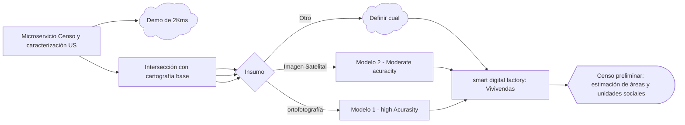

# evolution-pipeline
Pipeline propuesto para la optimización de los procesos de gestión predial del proyecto de la vía férrea, con un enfoque reutilizable y adaptable a otros proyectos de gestión predial.

