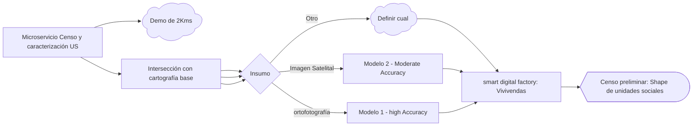
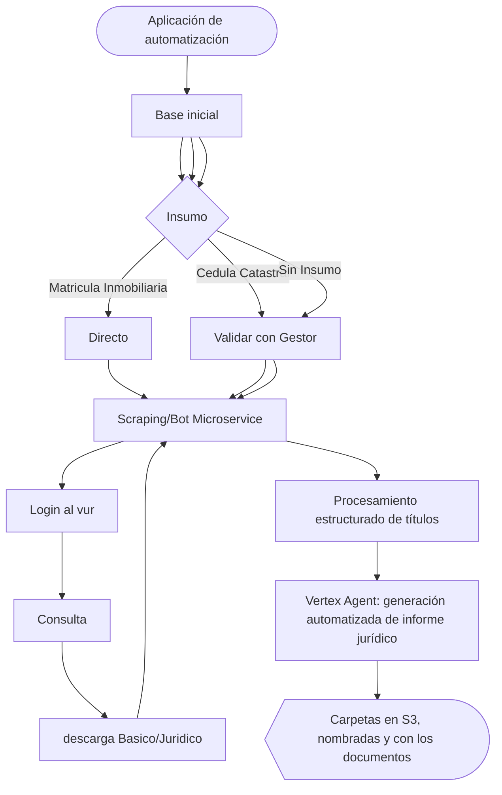

# evolution-pipeline
Pipeline propuesto para la optimización de los procesos de gestión predial del proyecto de la vía férrea, con un enfoque reutilizable y adaptable a otros proyectos de gestión predial.

## 1. Microservicio de Extracción de viviendas con teledetección:

Planteamos un microservicio qure reciba como insumo impágenes de la zona de interes, y por medio de un modelo entrenado reconozca las viviendas y retorne un shape de las mismas, el cual ademas de vectorizar la informacion permitira su discriminación y cuantificación, este insumo permitira concoer un valor aproximado de las unidades sociales, y su presicion dependera del insumo:

## 2. Aplicación de Análisis masivo de titulos

Planteemos una aplicación en la nube que integre un pipeline automatizado para la consulta, descarga y organización de información en carpetas, así como la generación y gestión de documentos, optimizando el flujo de trabajo y centralizando los procesos en una única plataforma.

